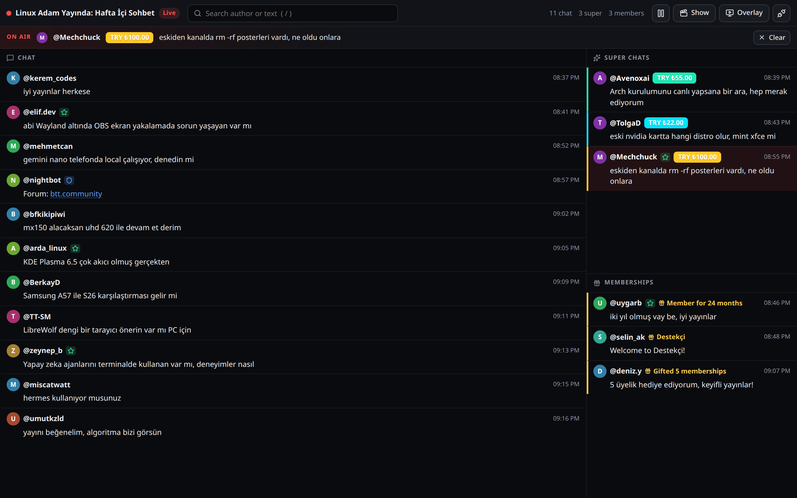
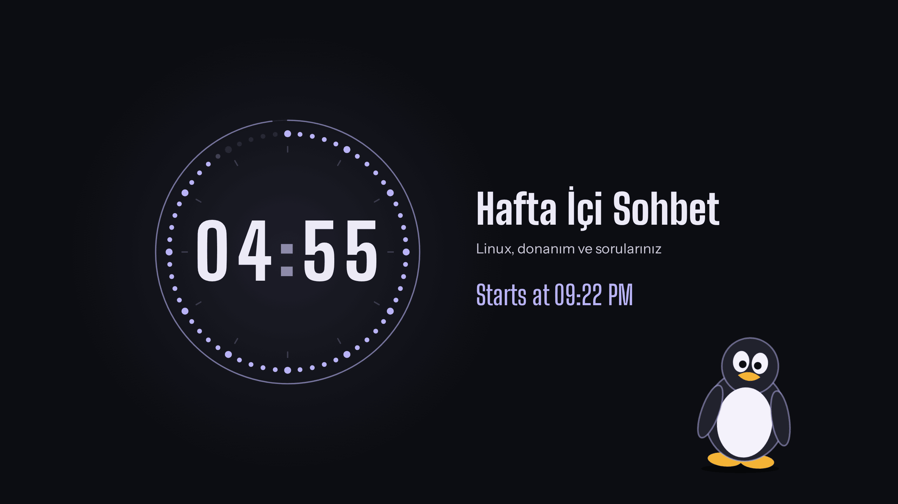

# YTChatHub



YouTube Live chat client for streamers. Click a message in the dashboard and it shows up on an OBS overlay. Super Chats, memberships, gifts, badges, custom emojis and full link URLs all come through, and a Show page adds a countdown, like goal, sponsor QR card, now-playing card and end-screen credits as separate browser sources.



## Run

Needs Node.js 20+ and pnpm.

```bash
pnpm install
pnpm build
pnpm start
```

Open `http://localhost:4100` and paste the stream URL. Add the link behind the dashboard's Overlay button to OBS as a Browser Source; the Show button opens the controls for the other overlays. For the now-playing card, run `scripts/now-playing.py <music folder>` on the OBS machine.

`pnpm dev` starts the backend on 4100 and the client on 3100 with hot reload. Set `YOUTUBE_LIVE_ID` to connect at startup, `PORT`/`HOST` to change where it listens (127.0.0.1 by default), and `MOCK_CHAT=1` for fake messages when nothing is connected.

Everything runs on your machine: a Fastify backend reads the chat with [youtubei.js](https://github.com/LuanRT/YouTube.js), pushes it over one WebSocket and serves the Next.js client; YouTube images are proxied and cached locally.
